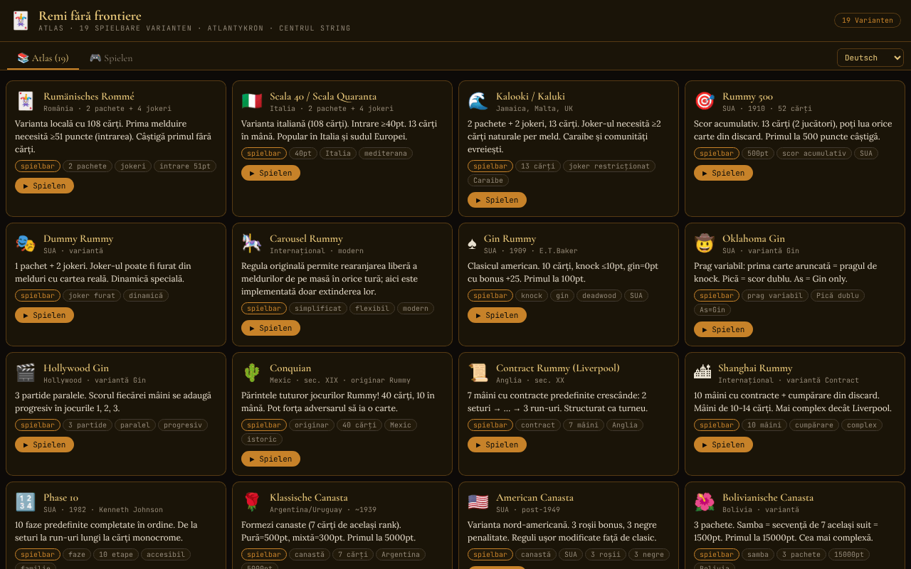

# Remi fără frontiere

[English](README.md) · [Română](README.ro.md) · [Français](README.fr.md) · [Italiano](README.it.md) · [Español](README.es.md) · [Português](README.pt.md) · **Deutsch** · [Magyar](README.hu.md)

**Version:** 1.2.8 · **Zuletzt aktualisiert:** 2026-10-23

Oberflächensprachen: **Română, English, Français, Italiano, Español, Português (PT), Deutsch, Magyar**

Ein Rommé-Atlas mit 19 Varianten, die gegen eine KI spielbar sind, in einer einzigen HTML-Datei.

**Online:** https://chiuta.github.io/Remi-fara-frontiere/

## Was es ist

Remi fără frontiere (Untertitel in der App: „Atlas · 19 spielbare Varianten · Atlantykron · Centrul StrING“) ist ein Atlas der Spiele aus der Rommé-Familie, in dem jede Variante gegen einen KI-Gegner gespielt werden kann. Die Oberfläche hat 8 Sprachen (RO, EN, FR, IT, ES, PT, DE, HU), mit großen Steinen und Karten.

## Funktionen

- Der Tab **Atlas (19)**: ein Steckbrief für jede Variante, mit Herkunft, Beschreibung, Schlagwörtern und der Schaltfläche „▶ Spielen“.
- Der Tab **Spielen**: Variantenauswahl, nach Typen gruppiert: *Mit gemeinsamem Tisch*, *Knock / Gin*, *Kontrakt*, *Phasen*, *Canasta*, *Steine*.
- Die 19 Varianten: Rumänisches Rommé, Scala 40, Kalooki, Rummy 500, Dummy Rummy, Carousel Rummy, Gin Rummy, Oklahoma Gin, Hollywood Gin, Conquian, Contract Rummy, Shanghai Rummy, Phase 10, Klassische Canasta, Amerikanische Canasta, Bolivianische Canasta, Okey (vereinfacht), Rummikub (vereinfacht), Mahjong (vereinfacht).
- Spielfeld mit Stapel, Ablagestapel, ausgelegten Kombinationen auf dem Tisch, Hand des Spielers, Punktestand (Du / KI), Statusmeldungen und Hilfetext mit den Regeln der aktuellen Variante.
- Variantenspezifische Elemente: der aktuelle Kontrakt (Contract/Shanghai), die Phasen (Phase 10), die Okey-Anzeige, Knock-/Gin-Schwellen.
- Lokale Statistiken pro Variante (Siege/Niederlagen), in der Variantenauswahl angezeigt, mit der Schaltfläche „Statistiken löschen“.
- Spiel gegen die KI; Endbildschirm mit „▶ Nochmal spielen“ und „✕ Schließen“.
- Kontextbezogene Hilfe in deinem Zug: Nach jeder Kartenauswahl sagt das Hilfefeld, was du tun kannst (ablegen, anlegen, ob die Auswahl eine Kombination bildet); der Auswahlzustand wird auch Screenreadern bereitgestellt (`aria-pressed`).
- Die wichtigsten interaktiven Elemente (Stapel, Ablagestapel) sind auch per Tastatur bedienbar (Eingabe / Leertaste).

## Bedienungsanleitung

1. Öffne die Seite; im Tab „📚 Atlas (19)“ liest du die Steckbriefe der Varianten.
2. Drücke „▶ Spielen“ auf einem Steckbrief oder wechsle zum Tab „🎮 Spielen“ und wähle die Variante unter „Wähle eine Variante zum Spielen gegen die KI“.
3. In deinem Zug (angezeigter Status: „Ziehen“): Ziehe eine Karte vom Stapel oder vom Ablagestapel.
4. Danach (Status „Aktion“): Nutze die unter dem Spielfeld angezeigten Aktionsschaltflächen (z. B. Kombinationen auslegen, Knock oder eine Karte ablegen, je nach Variante) und lies die Hinweise im Hilfebereich.
5. Verfolge den Punktestand in den Feldern „Du“ und „KI“; am Ende wähle „▶ Nochmal spielen“ oder „✕ Schließen“.
6. „← Auswahl“ bringt dich zurück zur Variantenauswahl.

## Datenschutz und Netzwerk

- Der einzige lokale Speicher: der Sieg-/Niederlagenzähler pro Variante in `localStorage` (Schlüssel `remi-ff:stat:v1`), auf deinem Gerät; kein IndexedDB und keine Cookies. Die App stellt keine Netzwerkanfragen (CSP mit `connect-src 'self'`, Skript nur per Hash erlaubt); die Schriftarten sind in die Datei eingebettet.
- Der Link „Coffee“ öffnet sich nur per Klick.
- Keine Analytics.

## Lokale Ausführung / offline

Lade `index.html` herunter und öffne sie im Browser; sie funktioniert vollständig ohne Internet.

## Lizenz

MIT-Lizenz — siehe Datei LICENSE

## Audit

2026-10-10: geprüft, dass es keine Netzwerkanfragen oder Speicherung gibt (Stand dieses Datums; seit Runde 6 gibt es nur den lokalen Statistikzähler); der „KI“-Gegner ist ein heuristischer Algorithmus in der Datei (ohne ML-Modell). Die Namen „Rummikub“ und „Phase 10“ sind Marken Dritter (hier als Namen von Spielvarianten verwendet); die Mahjong-Regeln sind vereinfacht. Kontrast und Navigationssemantik korrigiert.

## Marken und Handelsnamen

Die Namen „Rummikub“, „Phase 10“, „Canasta“, „Okey“ usw. sind Handelsnamen oder Marken ihrer Inhaber; hier werden sie beschreibend verwendet, als Namen von Spielvarianten, ohne Zugehörigkeit zu oder Billigung durch diese. Die App enthält keine Grafikmaterialien und keine offiziellen Regeln kommerzieller Produkte (die Regeln sind vereinfachte Annäherungen; siehe „Audit“).

## Verlauf / Changelog

### 1.2.8 — 2026-10-23

- CSP gehärtet: `blob:` aus `script-src` und `worker-src` entfernt (die App nutzt weder Worker noch Skripte aus `blob:`).

### 1.2.7 — 2026-10-23

- Die nativen `confirm()`-Dialoge wurden durch `FFF.dialog` ersetzt (barrierefrei, übersetzt; Kit 1.2.0); das Verhalten bleibt unverändert.

### 1.2.5 — 2026-10-22

fff-kit 1.1.4: Touch-Ziele und Mindestschriftgröße.

### 1.2.4 — 2026-10-22
- fff-kit 1.1.2: PBKDF2 mit 600.000 Iterationen, Schutz vor Clickjacking

### 1.2.3 — 2026-10-22

Feinschliff für Mobilgeräte und Barrierefreiheit: Text mit mindestens 12 px und Touch-Ziele von mindestens 24 px. das Zurücksetzen der Statistik fragt im Inline-Dialog des Kits (in 8 Sprachen übersetzt) statt im blockierenden `confirm()` nach; sichtbarer Tastaturfokus; Test `tests/r9-confirm.test.mjs`.

### 1.1.0 — 2026-10-14
- Datensicherung und Kennzeichnung von Daten (fff-kit).

### 1.0.0 — 2026-10-12
- Die Version und das Datum der letzten Aktualisierung werden in der App angezeigt (Ende des Atlas).

### 11. Oktober 2026 (Runde 7)
- Verbessert: Die Statusmeldung blieb „Wähle Karten und lege Kombinationen aus…“; jetzt reagiert der Hilfebereich auf die Auswahl (ablegen / anlegen / gültige Kombination oder was fehlt). Die Kartenauswahl hat `aria-pressed`, und der Hilfebereich ist `aria-live`.
- Behoben: Der Rang in der unteren Ecke der roten/schwarzen Karten hatte hellen Text auf cremefarbenem Grund (unzureichender Kontrast, von axe-core im Spiel gefunden).

### 11. Oktober 2026 (Runde 6)
- Hinzugefügt: lokale Statistiken (Siege/Niederlagen pro Variante) mit Zurücksetzen.
- Sicherheit: CSP mit hashbasiertem `script-src` statt `'unsafe-inline'`.

### 11. Oktober 2026
- Behoben: Okey und Rummikub sind in der App jetzt mit „(vereinfacht)“ gekennzeichnet, und die Regeltexte versprechen keine nicht implementierten Funktionen mehr (Umordnen des Tisches, Ausmachen mit 14+1, Mahjong-Hand 4+1): Es werden die Originalregel und das tatsächlich Implementierte angegeben (dieselbe Liste wie der Hinweis „Vereinfachte Implementierung“). Dasselbe gilt für Carousel Rummy.
- Behoben: Barrierefreiheit: `<main>`, h1-Überschrift, korrekte Überschriftenreihenfolge, Hand des Spielers per Tastatur fokussierbar, Endfenster mit Dialog-Rolle; 0 axe-core-Verstöße bei 1280 und 360 px, auch im Spielbildschirm.
- Geprüft: Alle 19 Varianten starten ohne JS-Fehler.
- Nicht implementiert (bleibt): eine Steine-Engine mit umordenbarem Tisch für Rummikub/Okey und die echte Gewinnbedingung beim Mahjong.

## Autor

Alexio — Alexandru-Ionuț Chiuță. Kontakt: alexio@trom.tf. Die App erwähnt Atlantykron und Centrul StrING im Untertitel.

## Zusammenfassung

Ein rumänischsprachiger Single-File-Atlas von 19 Spielen aus der Rommé-Familie (Rumänisches Rommé, Gin Rummy, Canasta, Okey, Rummikub, Phase 10, vereinfachtes Mahjong und mehr), jedes gegen einen KI-Gegner spielbar. Kein Speicher und keine Netzwerkanfragen. MIT-Lizenz.
