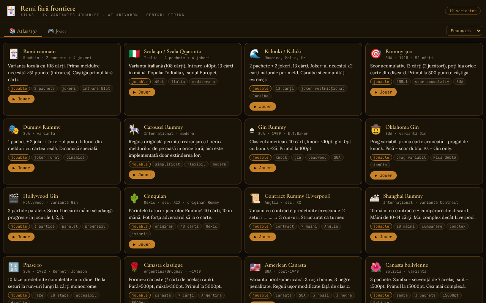

# Remi fără frontiere

[English](README.md) · [Română](README.ro.md) · **Français** · [Italiano](README.it.md) · [Español](README.es.md) · [Português](README.pt.md) · [Deutsch](README.de.md) · [Magyar](README.hu.md)

**Version :** 1.2.0 · **Dernière mise à jour :** 2026-10-19

Langues de l'interface : **Română, English, Français, Italiano, Español, Português (PT), Deutsch, Magyar**

Un atlas du rami avec 19 variantes jouables contre une IA, dans un seul fichier HTML.

**En ligne :** https://chiuta.github.io/Remi-fara-frontiere/

## Ce que c'est

Remi fără frontiere (sous-titre dans l'application : « Atlas · 19 variantes jouables · Atlantykron · Centrul StrING ») est un atlas des jeux de la famille du rami, dans lequel chaque variante peut être jouée contre un adversaire IA. L'interface compte 8 langues (RO, EN, FR, IT, ES, PT, DE, HU), avec de grandes tuiles et de grandes cartes.

## Fonctionnalités

- L'onglet **Atlas (19)** : une fiche pour chaque variante, avec origine, description, étiquettes et le bouton « ▶ Jouer ».
- L'onglet **Jouer** : sélecteur de variante, regroupé par types : *Avec table commune*, *Knock / Gin*, *Contrat*, *Phases*, *Canasta*, *Tuiles*.
- Les 19 variantes : Rami roumain, Scala 40, Kalooki, Rummy 500, Dummy Rummy, Carousel Rummy, Gin Rummy, Oklahoma Gin, Hollywood Gin, Conquian, Contract Rummy, Shanghai Rummy, Phase 10, Canasta classique, Canasta américaine, Canasta bolivienne, Okey (simplifié), Rummikub (simplifié), Mahjong (simplifié).
- Plateau de jeu avec pioche, pile de défausse, combinaisons posées sur la table, main du joueur, scores (Toi / IA), messages d'état et texte d'aide avec les règles de la variante en cours.
- Éléments propres à certaines variantes : le contrat en cours (Contract/Shanghai), les phases (Phase 10), l'indicateur Okey, les seuils de knock / gin.
- Statistiques locales par variante (victoires/défaites), affichées dans le sélecteur de variantes, avec un bouton « Effacer les statistiques ».
- Jeu contre l'IA ; écran de fin avec « ▶ Rejouer » et « ✕ Fermer ».
- Aide contextuelle pendant votre tour : après chaque sélection de cartes, le panneau d'aide indique ce que vous pouvez faire (défausser, compléter, si la sélection forme une combinaison) ; l'état de la sélection est aussi exposé aux lecteurs d'écran (`aria-pressed`).
- Les principaux éléments interactifs (pioche, défausse) sont aussi accessibles au clavier (Entrée / Espace).

## Mode d'emploi

1. Ouvrez la page ; dans l'onglet « 📚 Atlas (19) », lisez les fiches des variantes.
2. Appuyez sur « ▶ Jouer » sur une fiche, ou passez à l'onglet « 🎮 Jouer » et choisissez la variante dans « Choisissez une variante à jouer contre l'IA ».
3. À votre tour (état affiché : « Piochez ») : piochez une carte dans la pioche ou dans la pile de défausse.
4. Ensuite (état « Action ») : utilisez les boutons d'action affichés sous le plateau (p. ex. poser des combinaisons, faire knock ou défausser une carte, selon la variante) et lisez les indications de la zone d'aide.
5. Suivez le score dans les panneaux « Toi » et « IA » ; à la fin, choisissez « ▶ Rejouer » ou « ✕ Fermer ».
6. « ← Sélection » vous ramène au choix de la variante.

## Confidentialité et réseau

- Le seul stockage local : le compteur de victoires/défaites par variante dans `localStorage` (clé `remi-ff:stat:v1`), sur votre appareil ; ni IndexedDB ni cookies. L'application n'effectue aucun appel réseau (CSP avec `connect-src 'self'`, script autorisé uniquement par hachage) ; les polices sont intégrées au fichier.
- Le lien « Coffee » ne s'ouvre qu'au clic.
- Aucune analyse d'audience.

## Exécution locale / hors ligne

Téléchargez `index.html` et ouvrez-le dans un navigateur ; il fonctionne entièrement sans internet.

## Licence

Licence MIT — voir le fichier LICENSE

## Audit

2026-10-10 : vérifié qu'il n'y a ni requêtes réseau ni stockage (à cette date ; depuis le tour 6, il n'y a que le compteur local de statistiques) ; l'adversaire « IA » est un algorithme heuristique contenu dans le fichier (sans modèle ML). Les noms « Rummikub » et « Phase 10 » sont des marques de tiers (utilisées ici comme noms de variantes de jeu) ; les règles du Mahjong sont simplifiées. Contraste et sémantique de navigation corrigés.

## Marques et noms commerciaux

Les noms « Rummikub », « Phase 10 », « Canasta », « Okey », etc. sont des noms commerciaux ou des marques de leurs titulaires ; ils sont utilisés ici de façon descriptive, comme noms de variantes de jeu, sans affiliation ni approbation de leur part. L'application n'inclut ni matériel graphique ni règles officielles de produits commerciaux (les règles sont des approximations simplifiées ; voir « Audit »).

## Historique / Changelog

### 1.1.0 — 2026-10-14
- Sauvegarde et étiquetage des données (fff-kit).

### 1.0.0 — 2026-10-12
- La version et la date de la dernière mise à jour sont affichées dans l'application (fin de l'Atlas).

### 11 octobre 2026 (tour 7)
- Amélioré : le message d'état restait « Choisissez des cartes et posez des combinaisons… » ; désormais la zone d'aide réagit à la sélection (défausser / compléter / combinaison valide ou ce qui manque). La sélection des cartes a `aria-pressed`, et la zone d'aide est `aria-live`.
- Corrigé : le rang dans le coin inférieur des cartes rouges/noires avait un texte clair sur fond crème (contraste insuffisant, détecté par axe-core en cours de jeu).

### 11 octobre 2026 (tour 6)
- Ajouté : statistiques locales (victoires/défaites par variante) avec réinitialisation.
- Sécurité : CSP avec `script-src` par hachage à la place de `'unsafe-inline'`.

### 11 octobre 2026
- Corrigé : Okey et Rummikub sont désormais étiquetés « (simplifié) » dans l'application, et les textes de règles ne promettent plus de fonctions non implémentées (réorganisation de la table, sortie 14+1, main de Mahjong 4+1) : la règle originale et ce qui est réellement implémenté sont indiqués (même liste que la note « Implémentation simplifiée »). Même chose pour Carousel Rummy.
- Corrigé : accessibilité : `<main>`, titre h1, ordre correct des titres, main du joueur focalisable au clavier, fenêtre de fin avec le rôle dialog ; 0 violation axe-core à 1280 et 360 px, y compris dans l'écran de jeu.
- Vérifié : les 19 variantes démarrent sans erreur JS.
- Non implémenté (reste) : un moteur de tuiles avec table réarrangeable pour Rummikub/Okey et la vraie condition de victoire du Mahjong.

## Auteur

Alexio — Alexandru-Ionuț Chiuță. Contact : alexio@trom.tf. L'application mentionne Atlantykron et Centrul StrING dans son sous-titre.

## Résumé

Un atlas monofichier en langue roumaine de 19 jeux de la famille du rami (rami roumain, Gin Rummy, Canasta, Okey, Rummikub, Phase 10, Mahjong simplifié et d'autres), chacun jouable contre un adversaire IA. Aucun stockage et aucune requête réseau. Licence MIT.
