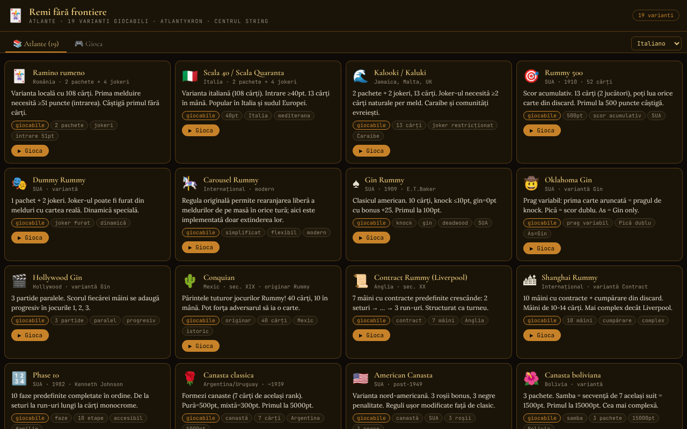

# Remi fără frontiere

[English](README.md) · [Română](README.ro.md) · [Français](README.fr.md) · **Italiano** · [Español](README.es.md) · [Português](README.pt.md) · [Deutsch](README.de.md) · [Magyar](README.hu.md)

**Versione:** 2.0.1 · **Ultimo aggiornamento:** 2026-10-27

Lingue dell'interfaccia: **Română, English, Français, Italiano, Español, Português (PT), Deutsch, Magyar**

Un atlante del ramino con 19 varianti giocabili contro un'IA, in un unico file HTML.

**Online:** https://chiuta.github.io/Remi-fara-frontiere/

## Che cos'è

Remi fără frontiere (sottotitolo nell'app: «Atlante · 19 varianti giocabili · Atlantykron · Centrul StrING») è un atlante dei giochi della famiglia del ramino, in cui ogni variante può essere giocata contro un avversario IA. L'interfaccia ha 8 lingue (RO, EN, FR, IT, ES, PT, DE, HU), con tessere e carte grandi.

## Funzioni

- La scheda **Atlante (19)**: una scheda per ogni variante, con origine, descrizione, etichette e il pulsante «▶ Gioca».
- La scheda **Gioca**: selettore di variante, raggruppato per tipi: *Con tavolo comune*, *Knock / Gin*, *Contratto*, *Fasi*, *Canasta*, *Tessere*.
- Le 19 varianti: Ramino rumeno, Scala 40, Kalooki, Rummy 500, Dummy Rummy, Carousel Rummy, Gin Rummy, Oklahoma Gin, Hollywood Gin, Conquian, Contract Rummy, Shanghai Rummy, Phase 10, Canasta classica, Canasta americana, Canasta boliviana, Okey (semplificato), Rummikub (semplificato), Mahjong (semplificato).
- Tavolo di gioco con mazzo, pila degli scarti, combinazioni sul tavolo, mano del giocatore, punteggi (Tu / IA), messaggi di stato e testo di aiuto con le regole della variante corrente.
- Elementi specifici: il contratto corrente (Contract/Shanghai), le fasi (Phase 10), l'indicatore Okey, le soglie di knock / gin.
- Statistiche locali per variante (vittorie/sconfitte), mostrate nel selettore delle varianti, con il pulsante «Cancella statistiche».
- Gioco contro l'IA; schermata finale con «▶ Gioca ancora» e «✕ Chiudi».
- Guida contestuale nel tuo turno: dopo ogni selezione di carte, il pannello di aiuto dice cosa puoi fare (scartare, estendere, se la selezione forma una combinazione); lo stato della selezione è esposto anche agli screen reader (`aria-pressed`).
- Gli elementi interattivi principali (mazzo, scarti) sono accessibili anche da tastiera (Invio / Spazio).

## Manuale d'uso

1. Apri la pagina; nella scheda «📚 Atlante (19)» leggi le schede delle varianti.
2. Premi «▶ Gioca» su una scheda, oppure passa alla scheda «🎮 Gioca» e scegli la variante da «Scegli una variante da giocare contro l'IA».
3. Nel tuo turno (stato mostrato: «Pesca»): pesca una carta dal mazzo o dalla pila degli scarti.
4. Poi (stato «Azione»): usa i pulsanti di azione mostrati sotto il tavolo (ad es. calare combinazioni, fare knock o scartare una carta, a seconda della variante) e leggi le indicazioni nell'area di aiuto.
5. Segui il punteggio nei pannelli «Tu» e «IA»; alla fine scegli «▶ Gioca ancora» o «✕ Chiudi».
6. «← Selezione» ti riporta alla scelta della variante.

## Privacy e rete

- L'unica memorizzazione locale: il contatore di vittorie/sconfitte per variante in `localStorage` (chiave `remi-ff:stat:v1`), sul tuo dispositivo; niente IndexedDB né cookie. L'app non effettua chiamate di rete (CSP con `connect-src 'self'`, script consentito solo tramite hash); i font sono incorporati nel file.
- Il link «Coffee» si apre solo al clic.
- Nessuna analitica.

## Esecuzione in locale / offline

Scarica `index.html` e aprilo nel browser; funziona completamente senza internet.

## Licenza

Licenza MIT — vedi il file LICENSE

## Audit

2026-10-10: verificato che non ci sono richieste di rete né memorizzazione (a quella data; dal round 6 esiste solo il contatore locale delle statistiche); l'avversario «IA» è un algoritmo euristico nel file (senza modello ML). I nomi «Rummikub» e «Phase 10» sono marchi di terzi (usati qui come nomi di varianti di gioco); le regole del Mahjong sono semplificate. Corretti il contrasto e la semantica di navigazione.

## Marchi e nomi commerciali

I nomi «Rummikub», «Phase 10», «Canasta», «Okey» ecc. sono nomi commerciali o marchi dei rispettivi titolari; qui sono usati in modo descrittivo, come nomi di varianti di gioco, senza affiliazione o approvazione da parte loro. L'app non include materiali grafici né regole ufficiali di prodotti commerciali (le regole sono approssimazioni semplificate; vedi «Audit»).

## Cronologia / Changelog

### 1.2.9 — 2026-10-23

- Bersagli touch di almeno 44 px sui dispositivi touch (`pointer:coarse`); il desktop resta invariato.

### 1.2.8 — 2026-10-23

- CSP rafforzata: rimosso `blob:` da `script-src` e `worker-src` (l’app non usa Worker né script da `blob:`).

### 1.2.7 — 2026-10-23

- I dialoghi nativi `confirm()` sono sostituiti da `FFF.dialog` (accessibile, tradotto; kit 1.2.0); il comportamento non cambia.

### 1.2.5 — 2026-10-22

fff-kit 1.1.4: target touch e dimensione minima del testo.

### 1.2.4 — 2026-10-22
- fff-kit 1.1.2: PBKDF2 con 600.000 iterazioni, protezione anti-clickjacking

### 1.2.3 — 2026-10-22

rifiniture per mobile e accessibilità: testo di almeno 12 px e aree tattili di almeno 24 px. il ripristino delle statistiche chiede conferma nella finestra in linea del kit (tradotta in 8 lingue) invece del `confirm()` bloccante; focus da tastiera visibile; test `tests/r9-confirm.test.mjs`.

### 1.1.0 — 2026-10-14
- Backup ed etichettatura dei dati (fff-kit).

### 1.0.0 — 2026-10-12
- La versione e la data dell'ultimo aggiornamento sono mostrate nell'app (in fondo all'Atlante).

### 11 ottobre 2026 (round 7)
- Migliorato: il messaggio di stato restava «Scegli le carte e cala le combinazioni…»; ora l'area di aiuto reagisce alla selezione (scarta / estendi / combinazione valida o cosa manca). La selezione delle carte ha `aria-pressed`, e l'area di aiuto è `aria-live`.
- Corretto: il valore nell'angolo inferiore delle carte rosse/nere aveva testo chiaro su sfondo crema (contrasto insufficiente, rilevato da axe-core durante il gioco).

### 11 ottobre 2026 (round 6)
- Aggiunto: statistiche locali (vittorie/sconfitte per variante) con azzeramento.
- Sicurezza: CSP con `script-src` basato su hash al posto di `'unsafe-inline'`.

### 11 ottobre 2026
- Corretto: Okey e Rummikub sono ora etichettati «(semplificato)» nell'app, e i testi delle regole non promettono più funzioni non implementate (riorganizzazione del tavolo, chiusura 14+1, mano di Mahjong 4+1): vengono indicate la regola originale e ciò che è effettivamente implementato (stessa lista della nota «Implementazione semplificata»). Lo stesso per Carousel Rummy.
- Corretto: accessibilità: `<main>`, titolo h1, ordine corretto dei titoli, mano del giocatore raggiungibile da tastiera, finestra finale con ruolo dialog; 0 violazioni axe-core a 1280 e 360 px, anche nella schermata di gioco.
- Verificato: tutte le 19 varianti si avviano senza errori JS.
- Non implementato (resta): un motore a tessere con tavolo riorganizzabile per Rummikub/Okey e la vera condizione di vittoria del Mahjong.

## Autore

Alexio — Alexandru-Ionuț Chiuță. Contatto: alexio@trom.tf. L'app menziona Atlantykron e Centrul StrING nel sottotitolo.

## Riepilogo

Un atlante in lingua rumena, in un unico file, di 19 giochi della famiglia del ramino (ramino rumeno, Gin Rummy, Canasta, Okey, Rummikub, Phase 10, Mahjong semplificato e altri), ciascuno giocabile contro un avversario IA. Nessuna memorizzazione e nessuna richiesta di rete. Licenza MIT.
