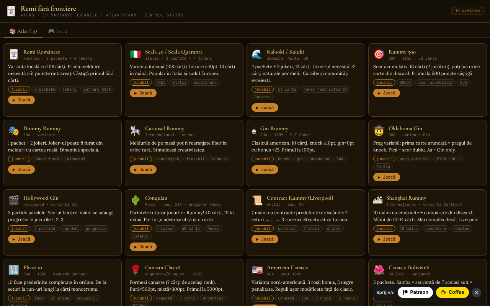

# Remi fără frontiere

Atlas de rummy cu 19 variante jucabile contra AI, într-un singur fișier HTML.

**Live:** https://chiuta.github.io/Remi-fara-frontiere/

**Versiune:** 1.0.0 · **Ultima actualizare:** 12 octombrie 2026

## Ce este

Remi fără frontiere (subtitlu în aplicație: „Atlas · 19 variante jucabile · Atlantykron · Centrul StrING") este un atlas al jocurilor din familia rummy, în care fiecare variantă poate fi jucată împotriva unui adversar AI. Interfața este în română, cu piese și cărți mari.

## Funcții

- Fila **Atlas (19)**: fișe pentru fiecare variantă, cu origine, descriere, etichete și butonul „▶ Joacă".
- Fila **Joacă**: selector de variantă, grupat pe tipuri: *Cu masă comună*, *Knock / Gin*, *Contract*, *Faze*, *Canasta*, *Plăcuțe*.
- Cele 19 variante: Remi Românesc, Scala 40, Kalooki, Rummy 500, Dummy Rummy, Carousel Rummy, Gin Rummy, Oklahoma Gin, Hollywood Gin, Conquian, Contract Rummy, Shanghai Rummy, Phase 10, Canasta Clasică, American Canasta, Canasta Boliviană, Okey (simplificat), Rummikub (simplificat), Mahjong (simplificat).
- Tablă de joc cu stoc, grămadă de aruncate, melduri pe masă, mâna jucătorului, scoruri (Tu / AI), mesaje de stare și text de ajutor cu regulile variantei curente.
- Elemente specifice: contractul curent (Contract/Shanghai), fazele (Phase 10), indicatorul Okey, praguri de knock / gin.
- Statistici locale pe variantă (victorii/înfrângeri), afișate în selectorul de variante, cu buton „Șterge statisticile”.
- Joc contra AI; ecran de final cu „▶ Joacă din nou" și „✕ Închide".
- Îndrumare contextuală în tura ta: după fiecare selecție de cărți, panoul de ajutor spune ce poți face (aruncă, extinde, dacă selecția formează un meld); starea selecției este expusă și cititoarelor de ecran (`aria-pressed`).
- Elementele interactive principale (stoc, aruncate) sunt accesibile și de la tastatură (Enter / Spațiu).

## Manual de utilizare

1. Deschideți pagina; în fila „📚 Atlas (19)" citiți fișele variantelor.
2. Apăsați „▶ Joacă" pe o fișă, sau treceți în fila „🎮 Joacă" și alegeți varianta din „Alege o variantă de jucat contra AI".
3. În tura dumneavoastră (starea afișată: „Trage"): trageți o carte din stoc sau din grămada de aruncate.
4. Apoi (starea „Acțiune"): folosiți butoanele de acțiune afișate sub tablă (de ex. coborârea de melduri, knock sau aruncarea unei cărți, în funcție de variantă) și citiți îndrumarea din zona de ajutor.
5. Urmăriți scorul în panourile „Tu" și „AI"; la final alegeți „▶ Joacă din nou" sau „✕ Închide".
6. „← Selectare" vă readuce la alegerea variantei.

## Confidențialitate și rețea

- Singura stocare locală: contorul de victorii/înfrângeri pe variantă în `localStorage` (cheia `remi-ff:stat:v1`), pe dispozitivul tău; fără IndexedDB sau cookie-uri. Aplicația nu face apeluri de rețea (CSP cu `connect-src 'self'`, scriptul permis doar pe bază de hash); fonturile sunt încorporate în fișier.
- Linkurile „Patreon" și „Coffee" se deschid doar la clic.
- Fără analitice.

## Rulare locală / offline

Descărcați `index.html` și deschideți-l în browser; funcționează complet fără internet.

## Licență

CC0 1.0 Universal (domeniu public) — vezi fișierul LICENSE

## Audit

2026-10-10: verificat că nu există cereri de rețea sau stocare (la acea dată; din runda 6 există doar contorul local de statistici); adversarul „AI" este un algoritm euristic în fișier (fără model ML). Numele „Rummikub" și „Phase 10" sunt mărci ale unor terți (folosite aici ca nume de variante de joc); regulile din Mahjong sunt simplificate. Corectate contrastul și semantica de navigare.

## Mărci și nume comerciale

Numele „Rummikub", „Phase 10", „Canasta", „Okey" etc. sunt nume comerciale sau mărci ale deținătorilor lor; aici sunt folosite descriptiv, ca nume ale unor variante de joc, fără afilierea sau aprobarea acestora. Aplicația nu include materiale grafice sau reguli oficiale ale produselor comerciale (regulile sunt aproximări simplificate; vezi „Audit").

## Istoric / Changelog

### 1.0.0 — 2026-10-12
- Versiunea și data ultimei actualizări sunt afișate în aplicație (sfârșitul Atlasului).

### 11 octombrie 2026 (runda 7)
- Îmbunătățit: mesajul de stare rămânea „Alege cărți și meldează…”; acum zona de ajutor reacționează la selecție (aruncă / extinde / meld valid sau ce lipsește). Selecția cărților are `aria-pressed`, iar zona de ajutor este `aria-live`.
- Reparat: rangul din colțul de jos al cărților roșii/negre avea text deschis pe fond crem (contrast insuficient, găsit de axe-core în joc).

### 11 octombrie 2026 (runda 6)
- Adăugat: statistici locale (victorii/înfrângeri pe variantă) cu resetare.
- Securitate: CSP cu `script-src` pe hash în locul `'unsafe-inline'`.

### 11 octombrie 2026
- Reparat: Okey și Rummikub sunt acum etichetate „(simplificat)” în aplicație, iar textele regulilor nu mai promit funcții neimplementate (rearanjarea mesei, închiderea 14+1, mâna Mahjong 4+1): se indică regula originală și ce este implementat efectiv (aceeași listă ca nota „Implementare simplificată”). Același lucru pentru Carousel Rummy.
- Reparat: accesibilitate: `<main>`, titlu h1, ordine corectă a titlurilor, mâna jucătorului focalizabilă de la tastatură, fereastra de final cu rol dialog; 0 violări axe-core la 1280 și 360 px, inclusiv în ecranul de joc.
- Verificat: toate cele 19 variante pornesc fără erori JS.
- Neimplementat (rămâne): motor cu plăcuțe pe masă rearanjabilă pentru Rummikub/Okey și condiția de câștig reală de Mahjong.

## Autor

Alexio — Alexandru-Ionuț Chiuță. Contact: alexio@trom.tf. Aplicația menționează Atlantykron și Centrul StrING în subtitlu.

## English summary

A single-file Romanian-language atlas of 19 rummy-family games (Romanian Rummy, Gin Rummy, Canasta, Okey, Rummikub, Phase 10, Mahjong simplified and more), each playable against an AI opponent. No storage and no network requests. CC0 1.0.
