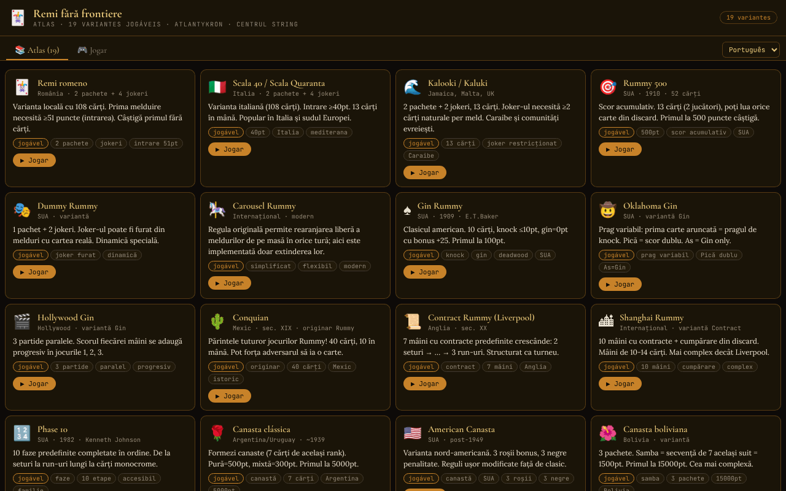

# Remi fără frontiere

[English](README.md) · [Română](README.ro.md) · [Français](README.fr.md) · [Italiano](README.it.md) · [Español](README.es.md) · **Português** · [Deutsch](README.de.md) · [Magyar](README.hu.md)

**Versão:** 1.2.1 · **Última atualização:** 2026-10-19

Idiomas da interface: **Română, English, Français, Italiano, Español, Português (PT), Deutsch, Magyar**

Um atlas do rummy com 19 variantes jogáveis contra uma IA, num único ficheiro HTML.

**Online:** https://chiuta.github.io/Remi-fara-frontiere/

## O que é

Remi fără frontiere (subtítulo na aplicação: «Atlas · 19 variantes jogáveis · Atlantykron · Centrul StrING») é um atlas dos jogos da família do rummy, em que cada variante pode ser jogada contra um adversário de IA. A interface tem 8 idiomas (RO, EN, FR, IT, ES, PT, DE, HU), com peças e cartas grandes.

## Funcionalidades

- O separador **Atlas (19)**: uma ficha para cada variante, com origem, descrição, etiquetas e o botão «▶ Jogar».
- O separador **Jogar**: seletor de variante, agrupado por tipos: *Com mesa comum*, *Knock / Gin*, *Contrato*, *Fases*, *Canasta*, *Peças*.
- As 19 variantes: Rummy romeno, Scala 40, Kalooki, Rummy 500, Dummy Rummy, Carousel Rummy, Gin Rummy, Oklahoma Gin, Hollywood Gin, Conquian, Contract Rummy, Shanghai Rummy, Phase 10, Canasta clássica, Canasta americana, Canasta boliviana, Okey (simplificado), Rummikub (simplificado), Mahjong (simplificado).
- Tabuleiro de jogo com baralho, pilha de descartes, combinações na mesa, mão do jogador, pontuações (Tu / IA), mensagens de estado e texto de ajuda com as regras da variante atual.
- Elementos específicos: o contrato atual (Contract/Shanghai), as fases (Phase 10), o indicador do Okey, os limiares de knock / gin.
- Estatísticas locais por variante (vitórias/derrotas), apresentadas no seletor de variantes, com o botão «Apagar estatísticas».
- Jogo contra a IA; ecrã final com «▶ Jogar de novo» e «✕ Fechar».
- Orientação contextual na tua vez: após cada seleção de cartas, o painel de ajuda diz o que podes fazer (descartar, estender, se a seleção forma uma combinação); o estado da seleção é também exposto aos leitores de ecrã (`aria-pressed`).
- Os principais elementos interativos (baralho, descartes) são acessíveis também pelo teclado (Enter / Espaço).

## Manual de utilização

1. Abre a página; no separador «📚 Atlas (19)» lê as fichas das variantes.
2. Prime «▶ Jogar» numa ficha, ou passa ao separador «🎮 Jogar» e escolhe a variante em «Escolhe uma variante para jogar contra a IA».
3. Na tua vez (estado apresentado: «Tira»): tira uma carta do baralho ou da pilha de descartes.
4. Depois (estado «Ação»): usa os botões de ação apresentados por baixo do tabuleiro (p. ex. baixar combinações, fazer knock ou descartar uma carta, consoante a variante) e lê a orientação na área de ajuda.
5. Acompanha a pontuação nos painéis «Tu» e «IA»; no fim escolhe «▶ Jogar de novo» ou «✕ Fechar».
6. «← Seleção» devolve-te à escolha da variante.

## Privacidade e rede

- O único armazenamento local: o contador de vitórias/derrotas por variante em `localStorage` (chave `remi-ff:stat:v1`), no teu dispositivo; sem IndexedDB nem cookies. A aplicação não faz chamadas de rede (CSP com `connect-src 'self'`, script permitido apenas por hash); os tipos de letra estão incorporados no ficheiro.
- A ligação «Coffee» só se abre ao clicar.
- Sem analítica.

## Execução local / offline

Transfere `index.html` e abre-o num navegador; funciona totalmente sem internet.

## Licença

Licença MIT — ver o ficheiro LICENSE

## Auditoria

2026-10-10: verificado que não existem pedidos de rede nem armazenamento (nessa data; desde a ronda 6 existe apenas o contador local de estatísticas); o adversário «IA» é um algoritmo heurístico no ficheiro (sem modelo de ML). Os nomes «Rummikub» e «Phase 10» são marcas de terceiros (usadas aqui como nomes de variantes de jogo); as regras do Mahjong estão simplificadas. Corrigidos o contraste e a semântica de navegação.

## Marcas e nomes comerciais

Os nomes «Rummikub», «Phase 10», «Canasta», «Okey», etc. são nomes comerciais ou marcas dos seus titulares; aqui são usados de forma descritiva, como nomes de variantes de jogo, sem afiliação ou aprovação por parte destes. A aplicação não inclui materiais gráficos nem regras oficiais de produtos comerciais (as regras são aproximações simplificadas; ver «Auditoria»).

## Histórico / Changelog

### 1.1.0 — 2026-10-14
- Cópia de segurança e etiquetagem de dados (fff-kit).

### 1.0.0 — 2026-10-12
- A versão e a data da última atualização são apresentadas na aplicação (no fim do Atlas).

### 11 de outubro de 2026 (ronda 7)
- Melhorado: a mensagem de estado ficava «Escolhe cartas e baixa combinações…»; agora a área de ajuda reage à seleção (descarta / estende / combinação válida ou o que falta). A seleção das cartas tem `aria-pressed`, e a área de ajuda é `aria-live`.
- Corrigido: o valor no canto inferior das cartas vermelhas/pretas tinha texto claro sobre fundo creme (contraste insuficiente, detetado pelo axe-core durante o jogo).

### 11 de outubro de 2026 (ronda 6)
- Adicionado: estatísticas locais (vitórias/derrotas por variante) com reposição.
- Segurança: CSP com `script-src` baseado em hash em vez de `'unsafe-inline'`.

### 11 de outubro de 2026
- Corrigido: o Okey e o Rummikub estão agora etiquetados «(simplificado)» na aplicação, e os textos das regras já não prometem funcionalidades não implementadas (reorganização da mesa, fecho 14+1, mão de Mahjong 4+1): indicam-se a regra original e o que está realmente implementado (a mesma lista da nota «Implementação simplificada»). O mesmo para o Carousel Rummy.
- Corrigido: acessibilidade: `<main>`, título h1, ordem correta dos títulos, mão do jogador focável pelo teclado, janela final com papel dialog; 0 violações axe-core a 1280 e 360 px, incluindo no ecrã de jogo.
- Verificado: as 19 variantes arrancam sem erros de JS.
- Não implementado (mantém-se): um motor de peças com mesa reorganizável para o Rummikub/Okey e a condição real de vitória do Mahjong.

## Autor

Alexio — Alexandru-Ionuț Chiuță. Contacto: alexio@trom.tf. A aplicação menciona Atlantykron e Centrul StrING no subtítulo.

## Resumo

Um atlas de ficheiro único, em língua romena, de 19 jogos da família do rummy (rummy romeno, Gin Rummy, Canasta, Okey, Rummikub, Phase 10, Mahjong simplificado e outros), cada um jogável contra um adversário de IA. Sem armazenamento e sem pedidos de rede. Licença MIT.
